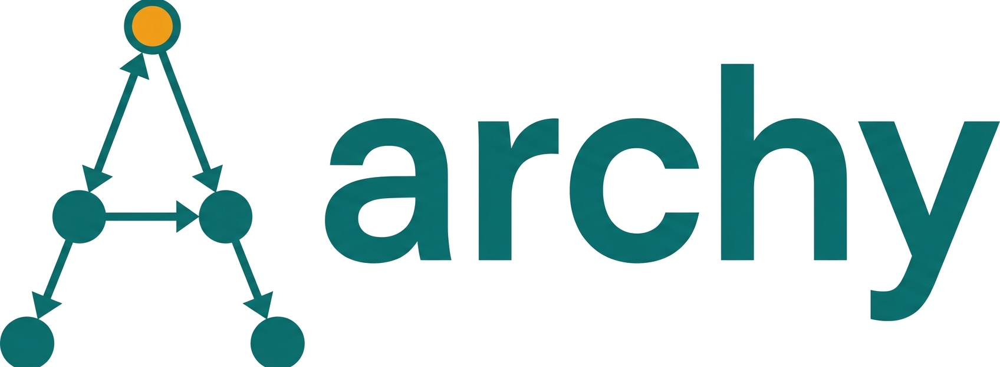

<!-- mcp-name: io.github.hslee16/archy -->

<p align="center"></p>

[](https://pypi.org/project/archy/)
[](https://pypi.org/project/archy/)
[](https://github.com/hslee16/archy/actions/workflows/ci.yml)
[](https://github.com/astral-sh/ruff)
[](LICENSE)
[](https://glama.ai/mcp/servers/hslee16/archy)

> **Your folders show your architecture. Your imports define your architecture.**
>
> `archy` is a CLI + MCP server that maps your Python package into a layered dependency graph, flags cycles, and tells you exactly which imports violate your layering rules.

## Why

Python packages grow fast. Without explicit layering, imports drift: `models` start importing `services`, `utils` start importing `api`, and the "clean" architecture you designed in week one is gone by week six.

`archy` makes the architecture **explicit and enforceable**:

1. **Declare layers** in a single `archy.toml` (or `pyproject.toml` section).
2. **Run `archy check`** to get a dependency graph, cycle detection, and layer-violation report.
3. **Expose the same analysis to AI agents** via the built-in MCP server.

No code changes required. No runtime overhead. Pure static analysis.

## Install

```bash
pip install archy
```

Requires Python 3.9+.

## Quick start

Given a package like:

```
myapp/
├── archy.toml
├── models/
│   ├── __init__.py
│   └── user.py
├── services/
│   ├── __init__.py
│   └── user_service.py
└── api/
    ├── __init__.py
    └── routes.py
```

Create `archy.toml`:

```toml
[archy]
root = "myapp"

[archy.layers]
core = ["
